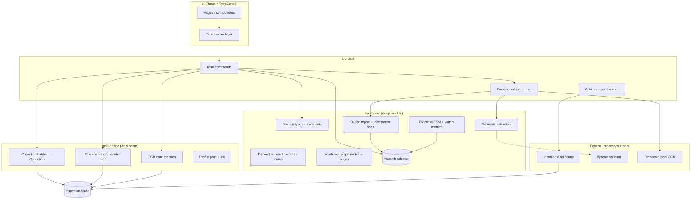

# Lessonbinder architecture (v1)

**Related:** `lessonbinder-charter.md`, `lessonbinder-domain.md`, `lessonbinder-SPEC.md`, `lessonbinder-workspace.md`
**Upstream reference (read-only):** `/home/xingzi/Documents/anki-main/rslib`

Desktop **Tauri 2** app with **React + TypeScript** UI. Domain logic lives in **`vault-core`** (deep module, no Anki). All **`anki`** / **`rslib`** access lives in **`anki-bridge`**. **`src-tauri`** is a thin orchestration shell: Tauri commands, persistence wiring, background jobs, and process launch for review.

---

## Two databases (never mix)

| Store                     | Path (under app data)                      | Owner                                            | Contents                                                                                                                                                                     |
| ------------------------- | ------------------------------------------ | ------------------------------------------------ | ---------------------------------------------------------------------------------------------------------------------------------------------------------------------------- |
| **Lessonbinder vault DB** | `{app_data}/vault.db`                      | `vault-core` (+ `src-tauri` persistence adapter) | `Library`, `Course`, `Lesson`, `Progress`, `Roadmap`, `SourceFile`, `PlaylistItem`, `TranscriptSegment`, `OcrSelection`, `AnkiCardLink`, order proposals, job queue metadata |
| **Anki collection**       | `{app_data}/anki-profile/collection.anki2` | `anki` / `rslib` via `anki-bridge`               | Notes, cards, revlog, decks, notetypes—**Anki’s schema only**                                                                                                                |

**Rules**

- **No Lessonbinder business tables** inside `collection.anki2` (no lessons, no watch %, no roadmaps in Anki SQL).
- **No raw SQL** against Anki tables from Lessonbinder code. Use `anki::collection::Collection` APIs opened with **`CollectionBuilder`** only.
- `vault.db` and `collection.anki2` are **separate files**; link rows in `AnkiCardLink` (vault) point at Anki note ids (collection).

### Anki profile directory

```
{app_data}/
├── vault.db
└── anki-profile/
    ├── collection.anki2      # Anki collection DB
    ├── collection.media/     # Anki media folder
    └── collection.media.db   # Anki media index
```

`CollectionBuilder::new("{app_data}/anki-profile/collection.anki2")` with media paths set to match Anki’s expected layout (same as Anki Desktop for a profile). Lessonbinder **creates** this profile on first run; it is **not** the user’s default `~/Anki` profile.

---

## Crate layout and dependency rules

```
lessonbinder/                    # product repo (this checkout)
├── crates/
│   ├── vault-core/           # domain + vault.db access
│   └── anki-bridge/          # only crate that links `anki`
├── src-tauri/                # Tauri app + commands + job runner
└── ui/                       # React + TypeScript (Vite)
```

### Forbidden imports (hard boundaries)

| Crate / tier      | **May** depend on                                                                                                      | **Forbidden**                                                                                                                                                                                                                               |
| ----------------- | ---------------------------------------------------------------------------------------------------------------------- | ------------------------------------------------------------------------------------------------------------------------------------------------------------------------------------------------------------------------------------------- |
| **`vault-core`**  | `serde`, `rusqlite` (or chosen SQL layer) for **`vault.db` only**, `thiserror`, time/uuid crates, pure Rust extractors | **`anki`**, **`anki_proto`**, **any path under `anki-main`**, **`tauri`**, opening **`collection.anki2`**, subprocess spawn of Anki                                                                                                         |
| **`anki-bridge`** | **`anki`** (workspace path dep to `rslib`), small shared DTOs if needed                                                | **`tauri`** (keeps bridge unit-testable without webview), **direct `rusqlite` / SQL strings** against Anki tables, **`vault-core`** if that would create a cycle—prefer **`src-tauri`** to pass primitives (note id, paths) across the seam |
| **`src-tauri`**   | `tauri`, `vault-core`, `anki-bridge`, job runtime (`tokio`)                                                            | **`anki`** directly—**must** call `anki-bridge` only                                                                                                                                                                                        |
| **`ui` (React)**  | Tauri IPC, TypeScript types                                                                                            | Rust crates, `vault.db`, `collection.anki2`                                                                                                                                                                                                 |

**Deletion test:** If `anki-bridge` were removed, `vault-core` should still compile and test import/progress/rollup entirely. If `vault-core` were removed, `anki-bridge` should still open a collection and add a note in isolation tests.

**Only one `anki` dependency:** `anki-bridge/Cargo.toml` is the sole workspace member that lists `anki = { path = "../../anki-main/rslib" }` (exact path TBD at repo setup). AGPL applies to distributed binaries linking `anki`.

---

## Module diagram



**Seams (Feathers):**

1. **UI ↔ Rust:** Tauri commands only; no shared DB handles in the webview.
2. **Vault ↔ Anki:** `anki-bridge` interface + `AnkiCardLink` in vault; card bodies only in collection.
3. **Foreground ↔ heavy work:** job runner; UI receives progress events, not blocking calls on the main thread.

---

## `vault-core` (deep module)

**Interface (small):** operations the app needs—`import_folder`, `reorder_lessons`, `accept_order_proposal`, `set_resume`, `mark_done`, `course_progress`, `roadmap_graph`, `delete_course`, etc.—implemented against **`vault.db`**.

**Implementation (large):** import rules (stem subtitles, idempotent keys), extractor orchestration, rollup pure functions, roadmap edge validation, link breakage on course delete.

**Adapters inside vault-core:**

- **VaultDb** — SQL for `vault.db` only.
- **FsScanner** — directory walk (hidden/`node_modules` rules).
- **ExtractorRegistry** — ffprobe, srt parse, pdf page probe; returns `known` / `unknown(reason)`.

Tests hit **`vault-core`** without Tauri or Anki (`cargo test -p vault-core`).

---

## `anki-bridge` (Anki seam)

**Interface:**

- `open_collection(profile_dir) -> Collection` via **`anki::collection::CollectionBuilder`**
- `ensure_profile(profile_dir)` — create `collection.anki2`, media folder, default deck `Lessonbinder`, notetype `Lessonbinder OCR` if missing
- `due_counts() -> DueSummary` — scheduler-backed counts; **no custom FSRS** in Lessonbinder
- `create_ocr_note(front, back, lesson_context) -> NoteId`
- **No** lesson/order/progress APIs here

**Implementation:** wraps `Collection` methods (`add_note`, queue queries, etc.). **Forbidden:** `SELECT`/`INSERT` handwritten against `notes`, `cards`, `revlog`.

Example builder usage (conceptual):

```rust
let col_path = profile_dir.join("collection.anki2");
let mut builder = CollectionBuilder::new(col_path);
builder.set_media_folder(profile_dir.join("collection.media"));
builder.set_media_db(profile_dir.join("collection.media.db"));
let col = builder.build()?;
```

Tests use a temp `anki-profile/` tree (`cargo test -p anki-bridge`).

---

## `src-tauri` (orchestration)

**Responsibilities**

- Register **Tauri commands** that call `vault-core` and `anki-bridge`.
- Resolve **`{app_data}`** paths (platform-specific via Tauri).
- Run **background jobs** (see below).
- **v1 review boundary:** read due counts through `anki-bridge`, then **launch the installed Anki binary** pointed at `{app_data}/anki-profile/` for full review UI (see next section).

**Forbidden:** `use anki::...` in `src-tauri`; import `anki_bridge::...` only.

---

## Background jobs (off UI thread)

Long work must not block the webview thread. **`src-tauri`** schedules jobs; handlers call into `vault-core` / OCR / (future) transcription.

| Job                     | Crate                                                                  | Notes                                                             |
| ----------------------- | ---------------------------------------------------------------------- | ----------------------------------------------------------------- |
| Folder scan / re-import | `vault-core`                                                           | Updates lessons, `broken`, idempotent keys                        |
| Metadata extractors     | `vault-core`                                                           | ffprobe optional; skip cleanly if missing                         |
| OCR on frame            | `anki-bridge` + Tesseract adapter in tauri or small `ocr` helper crate | Local only; then `create_ocr_note`                                |
| Transcription           | —                                                                      | **Out of v1** (charter); reserve job type for later Whisper slice |

**Pattern:** command enqueues job → worker runs → emits Tauri event / updates job row in `vault.db` → UI polls or listens.

---

## v1 review: due counts + Anki launch boundary

| Concern                    | Where it runs      | Mechanism                                                    |
| -------------------------- | ------------------ | ------------------------------------------------------------ |
| **Due counts**             | In-process         | `anki-bridge::due_counts()` on Lessonbinder `Collection`     |
| **OCR → note**             | In-process         | `anki-bridge::create_ocr_note()`                             |
| **Full review / study UI** | **Out-of-process** | **Installed Anki binary** launched with Lessonbinder profile |

**Launch boundary (v1):** `src-tauri` spawns the **system Anki executable** (discover via `PATH`, platform defaults, or user setting) with arguments/environment so Anki opens **`{app_data}/anki-profile/`**—not the user’s everyday profile. Lessonbinder does **not** embed Anki’s Qt UI; it **delegates** review to Anki Desktop while keeping vault state in `vault.db`.

**Failure modes:** Anki not installed → structured error in UI (counts may still work if collection exists). Wrong profile → prevented by always passing Lessonbinder profile path to launcher helper.

**Future (charter Decision 16):** in-app review via `rslib` without spawning Anki is a **later** adapter behind the same `anki-bridge` seam; v1 explicitly uses **binary launch** for study.

---

## React UI

- **Vite + React + TypeScript** under `ui/`.
- Calls thin **`invoke`** wrappers; displays `roadmap_graph` as SVG/canvas from JSON nodes/edges (SPEC R-01).
- No business logic duplicated: progress rollup only shown from server-computed `DerivedStatus`.

---

## Data flow examples

**Import folder:** UI → `import_folder` command → job → `vault-core` scan → `vault.db` → event → UI refresh.

**Mark lesson done:** UI → command → `vault-core` transition → `vault.db` → derived course status on read.

**OCR card:** UI frame + timestamp → job → Tesseract → `anki-bridge::create_ocr_note` → `AnkiCardLink` row in `vault.db`.

**Study:** UI → `due_counts` (sync) → display → user clicks Study → `launch_anki_profile()` → Anki binary opens `anki-profile`.

---

## Alignment notes

- **SPEC S-01–S-03** assumed in-process study; **this document** is authoritative for **v1 review**: **due counts in-process, study via Anki binary** on the dedicated profile.
- **Transcription / Whisper:** not scheduled in v1 job table.
- **Playlist courses:** `vault-core` types may exist; importer jobs gated until post–folder MVP (SPEC `#[ignore]` tests).

---

## Checklist (prompt 06 done-when)

| Item                                                   | Documented |
| ------------------------------------------------------ | ---------- |
| Crates: `vault-core`, `anki-bridge`, `src-tauri`, `ui` | Yes        |
| `vault.db` vs `collection.anki2`                       | Yes        |
| Profile path `{app_data}/anki-profile/`                | Yes        |
| `CollectionBuilder`, no raw Anki SQL                   | Yes        |
| Background jobs off UI thread                          | Yes        |
| Anki launch boundary for v1 review                     | Yes        |
| Module diagram + forbidden imports                     | Yes        |
